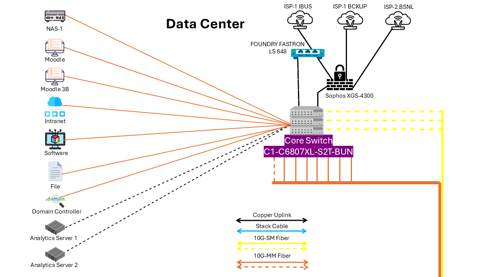
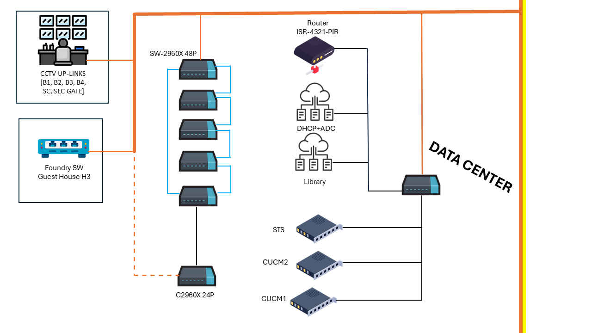
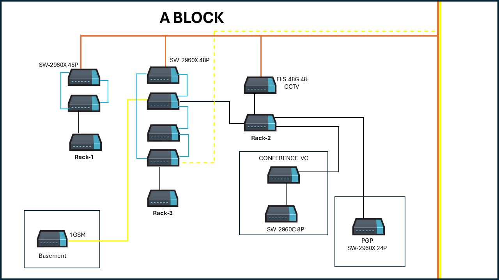
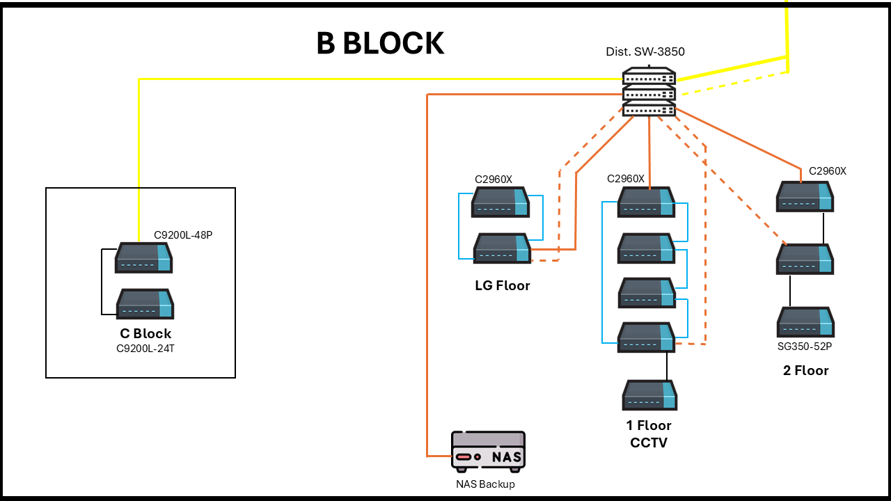

# Network Diagrams

## 1. Introduction

This section contains sample network diagrams created to demonstrate my understanding of campus network architecture, network devices, connectivity and documentation.

## 2. Campus Network Architecture

A typical campus network consists of the following layers:

- **Core Layer:** Provides high-speed connectivity between network segments.
- **Distribution Layer:** Connects access switches and manages network traffic.
- **Access Layer:** Connects end-user devices such as computers, printers and IP phones.
- **Firewall:** Provides network security and traffic filtering.
- **Wireless Access Points:** Provide wireless network connectivity.

## 3. Sample Campus Network Topology

```text
                 Internet
                    |
                 Firewall
                    |
                Core Switch
                    |
          ---------------------
          |                   |
    Distribution SW      Distribution SW
          |                   |
     Access Switches      Access Switches
          |                   |
    ----------------     ----------------
    |       |      |     |       |      |
   PCs    Phones Printers PCs   APs   Laptops
```

## 4. Network Diagram Presentation

The following slides demonstrate sample campus network diagrams.

### Slide 1 – Network Overview



### Slide 2 – Network Architecture



### Slide 3 – Network Connectivity



### Slide 4 – Network Details



**PowerPoint Presentation:** [View or Download Network Diagram Presentation](./Github%20Network%20Diagram.pptx)

## 5. Common Network Devices

| Device | Purpose |
|---|---|
| Core Switch | Main network connectivity |
| Distribution Switch | Connects access switches |
| Access Switch | Connects end-user devices |
| Firewall | Network security |
| Wireless Access Point | Wireless connectivity |
| Router | Connects different networks |

## 6. Network Diagram Tools

- Draw.io
- Microsoft Visio
- Cisco Packet Tracer
- EVE-NG

## 7. Network Documentation Best Practices

- Use clear device names.
- Mention VLAN IDs where appropriate.
- Show switch connections and uplinks.
- Identify core, distribution and access layers.
- Keep diagrams updated.
- Avoid sharing confidential network information.

## 8. Skills Demonstrated

- Campus network architecture
- Cisco switching concepts
- Network topology documentation
- Network device identification
- Network connectivity understanding
- Technical documentation

## 9. Learning Objectives

- Understand campus network architecture.
- Learn how network devices are interconnected.
- Improve network documentation skills.
- Develop practical networking knowledge.

## 10. Disclaimer

These diagrams are created for educational and portfolio purposes using sample network information. They do not represent an actual company or campus network.
